# TechPlanner — Manuale d'uso

Aggiornato il 10 novembre 2026

Questo manuale spiega TechPlanner a chi non l'ha mai usato: ogni operazione è divisa in passi corti, con la schermata vera e riquadri rossi numerati sui pulsanti da premere.

## Come usare questo manuale

Non serve leggerlo tutto: guarda la tabella «Chi sei?» qui sotto e vai al tuo capitolo. Nelle schermate, i **riquadri rossi numerati** indicano dove cliccare, nell'ordine dei passi.

TechPlanner serve a chi controlla gli apparecchi radiologici degli studi medici e dentistici. In pratica tiene in ordine quattro cose: chi sono i clienti, quali apparecchi hanno, quando sono stati verificati e quando tornare.

Parole che troverai spesso:

| Parola | Cosa vuol dire |
| --- | --- |
| Pannello | Il programma che si apre nel browser dopo l'accesso |
| Menu | La colonna a sinistra con le voci (Clienti, Apparecchi…) |
| Elenco | La tabella con tutte le schede di un tipo, per esempio tutti i clienti |
| Scheda | La pagina di un solo cliente o di un solo apparecchio |
| Linguetta | Le voci in fila sopra una tabella dentro una scheda (Apparecchi, Chiamate…): clicchi e cambia il contenuto |
| Finestra | Il riquadro che si apre sopra la pagina per compilare qualcosa; si chiude con la X o con Annulla |
| Campo obbligatorio | Un campo con l'asterisco rosso (\*): senza, il salvataggio non parte |
| Verifica | Il controllo periodico di un apparecchio, con la data del prossimo |
| Cestino | Dove finisce un record eliminato: si può ancora ripristinare finché l'amministratore non lo elimina definitivamente |

## Chi sei? Trova il tuo capitolo

TechPlanner ha cinque tipi di utente. Cosa vedi dipende dal **ruolo** che ti ha dato l'amministratore: senza il ruolo giusto, la pagina di accesso risponde «I dati di accesso non sono corretti» anche se la password è giusta.

| Chi sei | Cosa fai | Ruolo da chiedere all'amministratore | Capitoli da leggere |
| --- | --- | --- | --- |
| Segreteria | Tieni l'anagrafica dei clienti, telefoni, fissi gli appuntamenti | `techplanner::operator` | Per tutti, Segreteria (clienti), Segreteria (chiamate e appuntamenti), Referenti |
| Tecnico verificatore | Vai dai clienti, registri apparecchi e verifiche | `techplanner::operator` | Per tutti, Tecnico |
| Responsabile dei dati | Come la segreteria, e in più elimini, ripristini e gestisci i modelli e-mail | `techplanner::admin` | Per tutti, Segreteria, Amministratore (cestino) |
| Amministratore | Crei gli utenti, dai i ruoli, vedi e fai tutto | `super-admin` | Tutti, soprattutto Amministratore |
| Gestore degli utenti | Crei utenti e dai ruoli, senza toccare i dati dei clienti | `user::admin` | Amministratore |
| Cliente o visitatore del sito | Chiedi una consulenza dal sito, ti registri | Nessuno | Clienti e visitatori del sito |

Segreteria e tecnico hanno lo **stesso** ruolo, «operatore»: vedono e modificano gli stessi dati, ma **non possono eliminare** nulla. Per questo nelle loro tabelle manca il cestino rosso. Eliminare e ripristinare è compito del responsabile dei dati o dell'amministratore.

## Per tutti: entrare, muoversi, uscire

### Entrare

1. Apri il browser (Chrome, Edge, Firefox o Safari) e scrivi l'indirizzo del sito seguito da `/techplanner/admin`. L'indirizzo esatto te lo dà l'amministratore.
2. Nel riquadro **1** scrivi la tua e-mail.
3. Nel riquadro **2** scrivi la password. Se vuoi controllare cosa hai scritto, premi «Mostra password».
4. Premi **Accedi** (riquadro **3**).

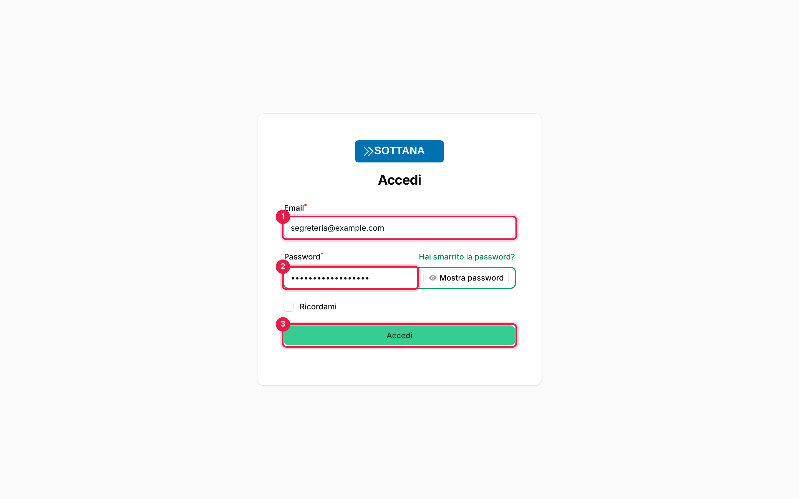

*Figura 1 — La pagina di accesso.*

Se compare «I dati di accesso non sono corretti», controlla e-mail e password. Se sono giuste, al tuo utente manca il ruolo: chiedi all'amministratore. Dopo troppi tentativi sbagliati il sistema ti blocca per qualche minuto: aspetta e riprova. Password dimenticata? Usa «Hai smarrito la password?».

### Il menu

Dopo l'accesso, a sinistra c'è il menu. Le voci sono divise in due gruppi, che puoi chiudere e riaprire con la freccina (riquadri **1** e **2**):

- **Lavoro quotidiano**: Clienti, Apparecchi, Chiamate, Appuntamenti.
- **Referenti dei clienti**: Direttori sanitari, Rappresentanti legali, Sedi legali.

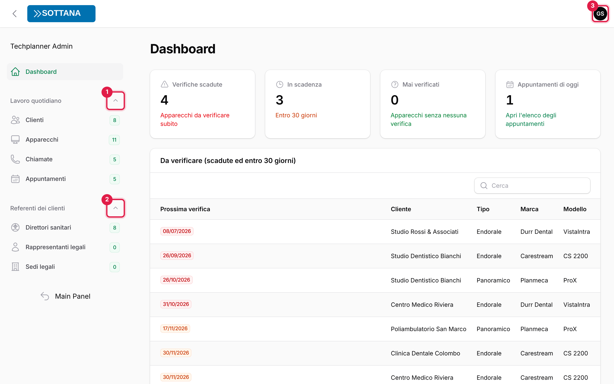

*Figura 2 — Il menu a sinistra.*

### La pagina iniziale: cosa fare oggi

Appena entri vedi la **Dashboard**, che risponde alla domanda «cosa devo fare oggi?»:

1. **Verifiche scadute** (riquadro **1**): quanti apparecchi andavano già verificati. Se il numero è rosso, c'è da recuperare.
2. **In scadenza** (riquadro **2**): quanti apparecchi vanno verificati nei prossimi 30 giorni. Gli altri due riquadri dicono quanti apparecchi non hanno mai avuto una verifica e quanti appuntamenti ci sono oggi.
3. **Da verificare** (riquadro **3**): l'elenco degli apparecchi scaduti o in scadenza, dal più urgente. Clicca una riga per aprire la scheda dell'apparecchio.
4. **Il giro di oggi** (riquadro **4**): gli appuntamenti di oggi in ordine di orario, con le note per il tecnico.

Cliccando un riquadro in alto si apre l'elenco già filtrato.

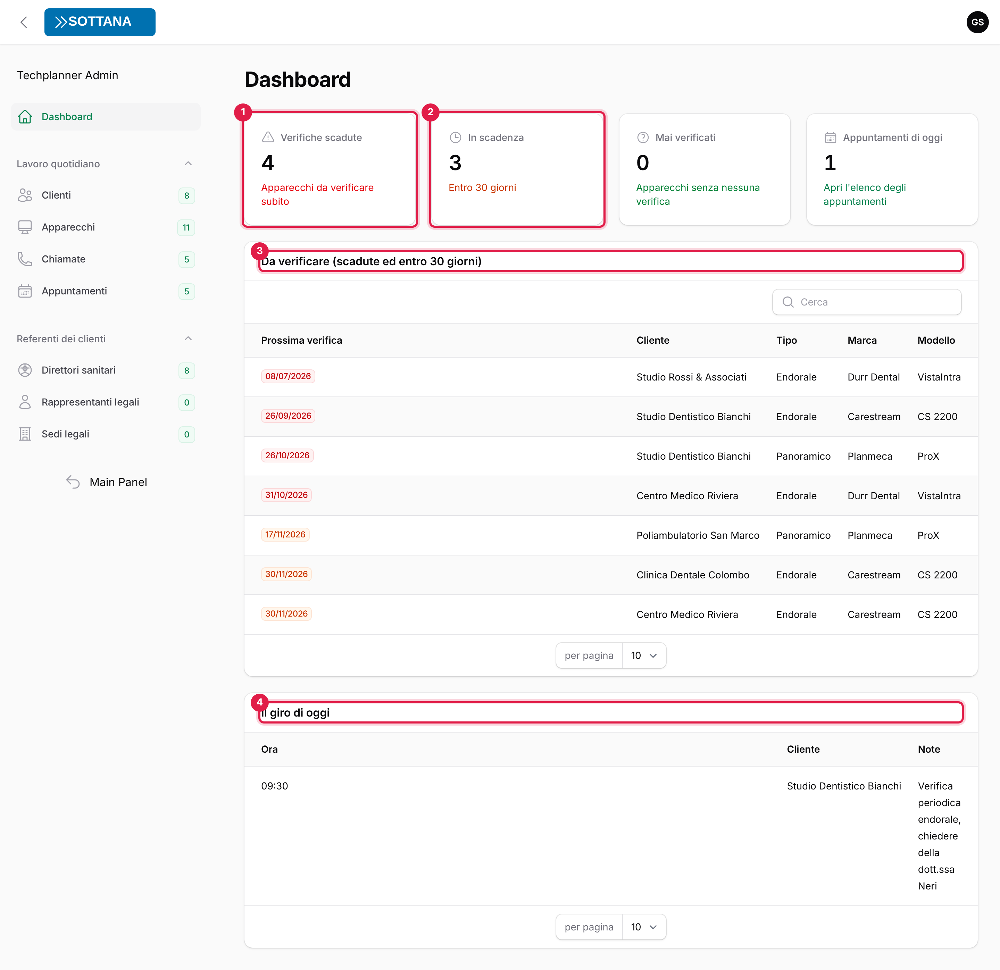

*Figura 3 — La pagina iniziale.*

### Uscire

1. In alto a destra clicca il cerchio con le tue iniziali.
2. Premi **Disconnetti**.

Dallo stesso menu puoi scegliere lo sfondo chiaro, scuro o quello del computer.

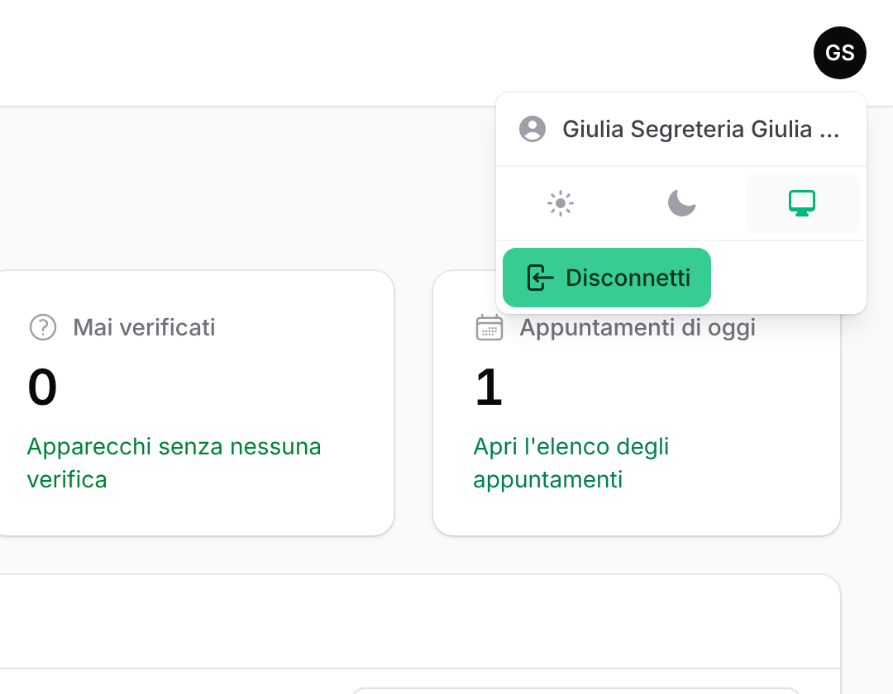

*Figura 4 — Il menu utente, con Disconnetti.*

## Segreteria: i clienti

Clicca **Clienti** nel menu. Si apre l'elenco di tutti i clienti attivi.

### Trovare un cliente

- **Cerca** (riquadro **2**): scrivi una parte del nome o dell'attività, per esempio «Bianchi» o «dentistico». L'elenco si restringe mentre scrivi.
- **Filtri** (riquadro **3**): «Cessato» è impostato su *No*, quindi i clienti che hanno chiuso non compaiono. Per vederli scegli *Sì* o *Tutti*. «Attività» mostra solo un tipo di studio. Dopo aver scelto, premi **Applica filtri**; **Reimposta** torna come prima.
- In ogni riga trovi: l'occhio per **aprire** la scheda, la matita per **modificare** e il pulsante **Ordina per distanza** (riquadro **4**, spiegato nel capitolo successivo). Il responsabile dei dati vede anche il cestino rosso per **eliminare**: il cliente finisce nel cestino insieme ai suoi apparecchi, verifiche e chiamate, e si può ripristinare (capitolo Amministratore).

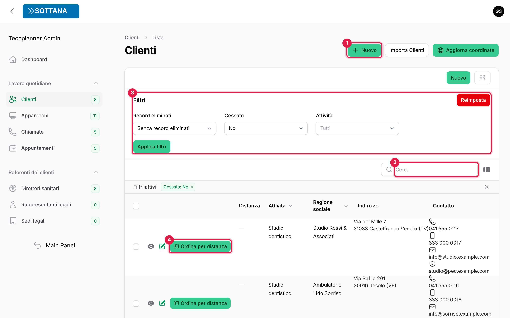

*Figura 5 — L'elenco dei clienti.*

### Aggiungere un cliente nuovo

1. Premi **Nuovo** in alto (riquadro **1** della figura 5).
2. In **Dati azienda** scrivi almeno la **Ragione sociale** (obbligatoria). Se ce l'hai, aggiungi attività, partita IVA e codice fiscale.
3. In **Indirizzo** compila via, civico, CAP, comune e provincia. Servono anche per calcolare la distanza dagli altri clienti.
4. In **Contatti** scrivi telefono, cellulare, e-mail e PEC.
5. Scrivi l'**ASL/ULSS competente** e, se serve, delle **Note** (per esempio «ingresso dal cortile»).
6. Premi **Salva**. Con **Salva & nuovo** salvi e riparti subito con un altro cliente.

Partita IVA e codice fiscale vengono controllati: se c'è un errore di battitura il salvataggio non parte e sotto il campo compare cosa correggere. Spazi e minuscole vanno bene, li sistema il programma.

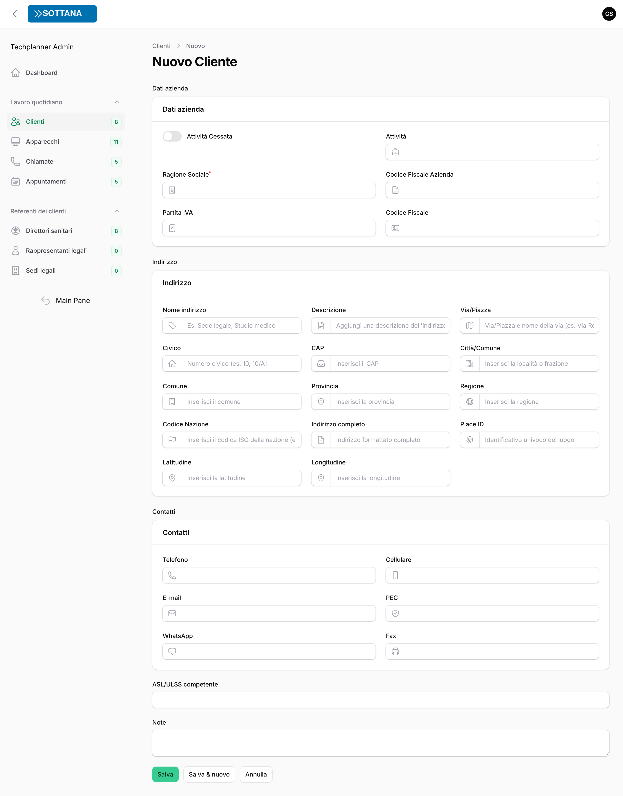

*Figura 6 — Il modulo per un cliente nuovo.*

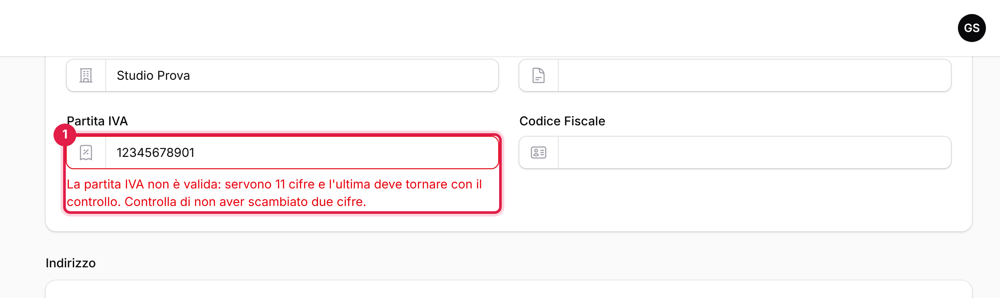

*Figura 7 — Una partita IVA sbagliata: il messaggio dice cosa controllare.*

### La scheda del cliente

Dall'elenco premi l'occhio. In alto ci sono i dati, sotto una fila di linguette: **Appuntamenti, Apparecchi, Sedi legali, Rappresentanti legali, Direttori sanitari, Chiamate** (riquadro **2**). Ogni linguetta mostra le cose di quel cliente e ha un **+** per aggiungerne di nuove, già collegate al cliente. **Modifica** (riquadro **1**) apre il modulo per correggere i dati.

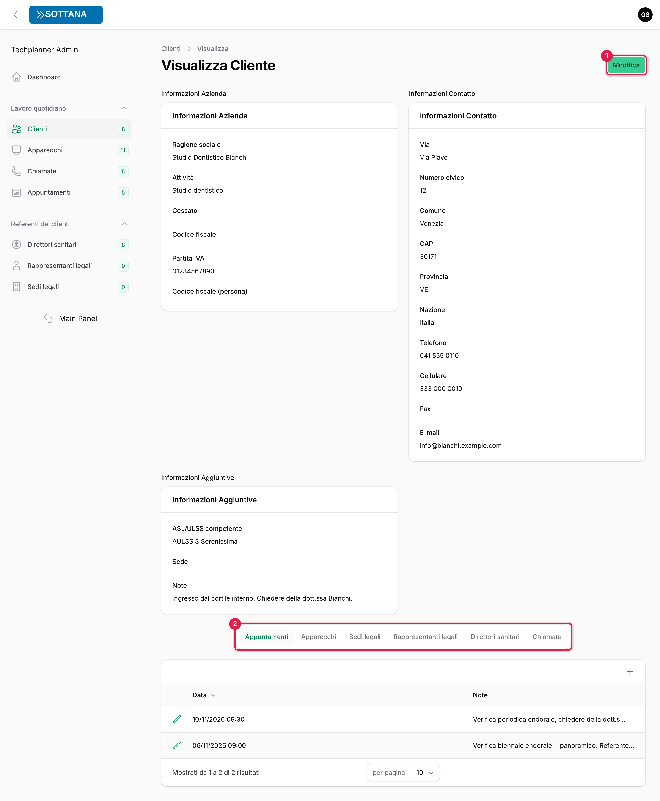

*Figura 8 — La scheda di un cliente.*

### Importare molti clienti da un file

Se hai un elenco in Excel, salvalo come CSV e usa **Importa Clienti** in cima all'elenco. Nella finestra c'è «Scarica un file CSV di esempio»: aprilo per vedere le colonne giuste, copia i tuoi dati in quel formato, scegli il file e premi **Importa**. L'importazione lavora in sottofondo; alla fine una notifica dice quante righe sono entrate e quante no.

Puoi reimportare lo stesso file senza creare doppioni: se una riga ha lo stesso codice (id), la stessa partita IVA o lo stesso codice fiscale di un cliente già presente, quel cliente viene **aggiornato**. Solo le righe che non corrispondono a nessuno diventano clienti nuovi.

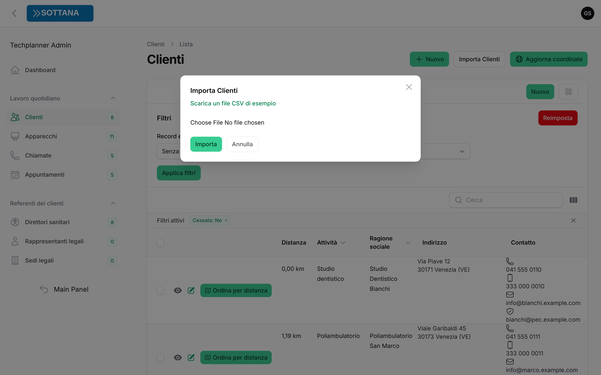

*Figura 9 — La finestra di importazione.*

## Segreteria: chiamate, appuntamenti e giro di visite

Il lavoro di ogni giorno segue tre passi: telefoni al cliente, annoti com'è andata, fissi l'appuntamento. Poi guardi chi c'è vicino per mettere più visite nella stessa giornata.

### Annotare una telefonata

1. Apri la scheda del cliente (occhio nell'elenco Clienti).
2. Scorri fino alle linguette e clicca **Chiamate** (riquadro **1**).
3. Premi il **+** (riquadro **2**).

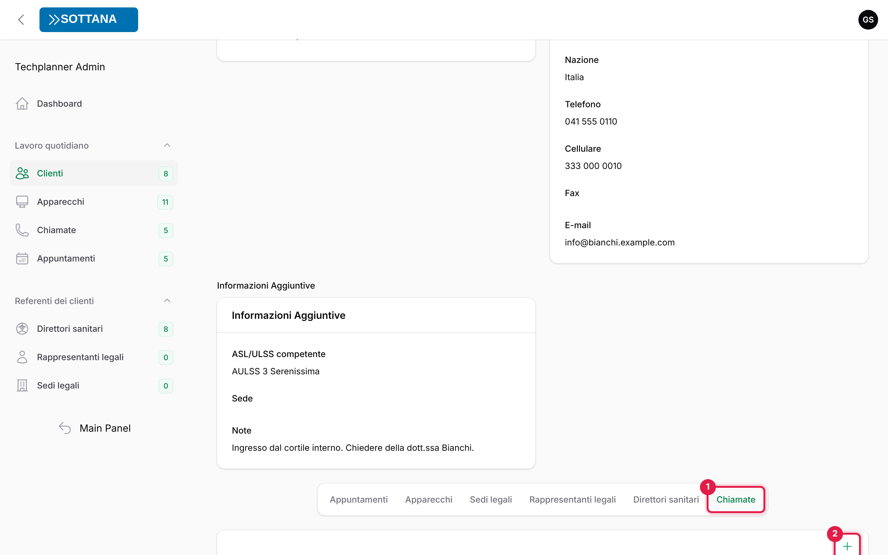

*Figura 10 — La linguetta Chiamate nella scheda del cliente.*

4. Nella finestra compila:
   - **Data e ora** della telefonata;
   - **Durata (secondi)**: 3 minuti sono 180;
   - **Esito e note**: com'è andata, per esempio «fissata la visita per giovedì alle 9» o «richiamare lunedì»;
   - **Direzione**: *Uscita* se hai chiamato tu, *Entrata* se ha chiamato il cliente.
5. Premi **Salva**. La chiamata compare nella linguetta, con le altre di quel cliente.

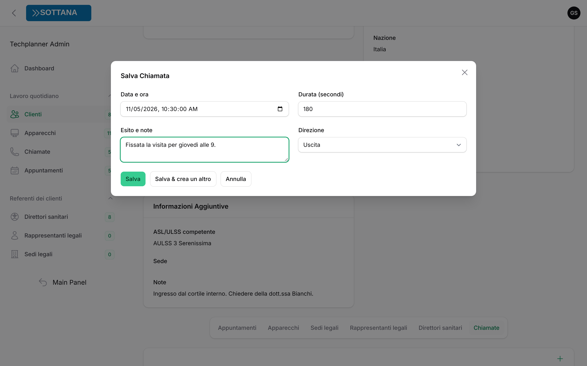

*Figura 11 — La finestra di una chiamata nuova.*

### Le richieste arrivate dal sito

Quando qualcuno compila il modulo «Contatti» del sito, la richiesta compare nel menu **Richieste dal sito** (riquadro **1**). Il numero accanto alla voce conta quelle arrivate negli ultimi 7 giorni.

1. Clicca **Richieste dal sito**: le richieste sono in ordine di arrivo, la più recente in alto.
2. Premi l'occhio sulla riga (riquadro **2**) per leggere il messaggio intero, con telefono ed e-mail per rispondere.
3. La colonna **Inoltro** dice se la richiesta è arrivata anche per e-mail: *Inoltrata per e-mail*, *Da inoltrare* (casella non ancora impostata) o *Inoltro fallito*. Se vedi spesso «Inoltro fallito», avvisa l'amministratore.
4. Richiama la persona e, se diventa un cliente, crealo da **Clienti**: le richieste non si modificano, restano come le ha scritte il visitatore.

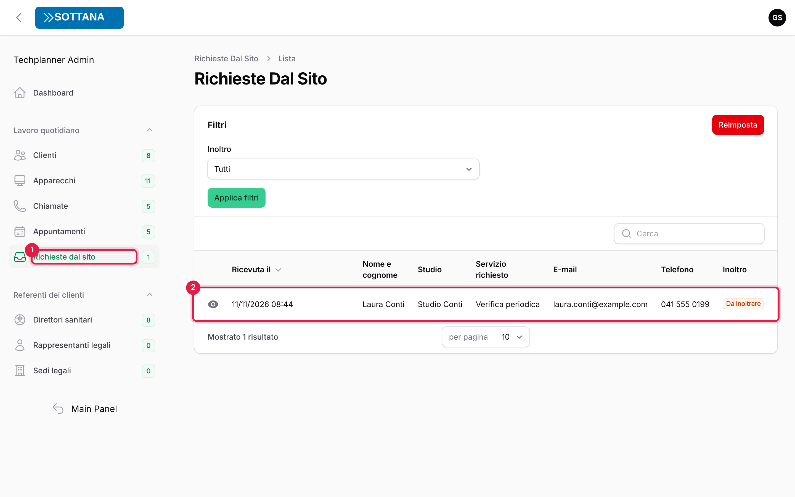

*Figura 12 — Le richieste arrivate dal modulo «Contatti» del sito.*

### Fissare un appuntamento

1. Nel menu clicca **Appuntamenti**, poi **Nuovo**. (In alternativa: linguetta Appuntamenti nella scheda del cliente, poi **+**.)
2. In **Cliente** scrivi una parte del nome e sceglilo dall'elenco che si apre.
3. Scegli **Data e ora**.
4. In **Note** scrivi quello che serve al tecnico: chi cercare, quali apparecchi, come entrare.
5. Premi **Salva** (riquadro **1**).

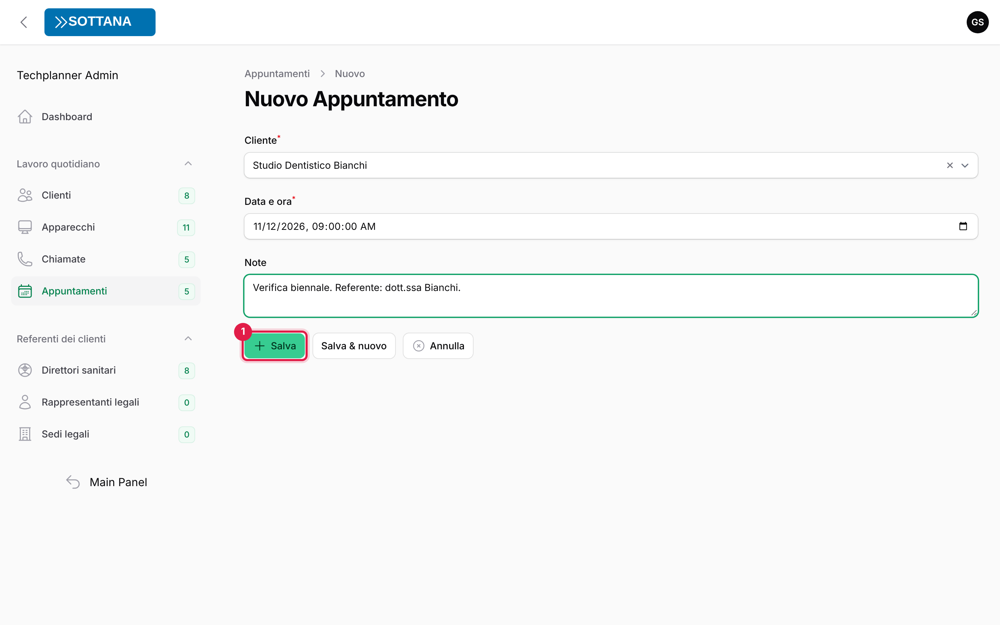

*Figura 13 — Un appuntamento nuovo.*

L'elenco **Appuntamenti** fa da agenda: clicca il titolo **Data e ora** (riquadro **1**) per metterli in ordine di data. Oggi non c'è un calendario grafico e non si può assegnare l'appuntamento a un tecnico.

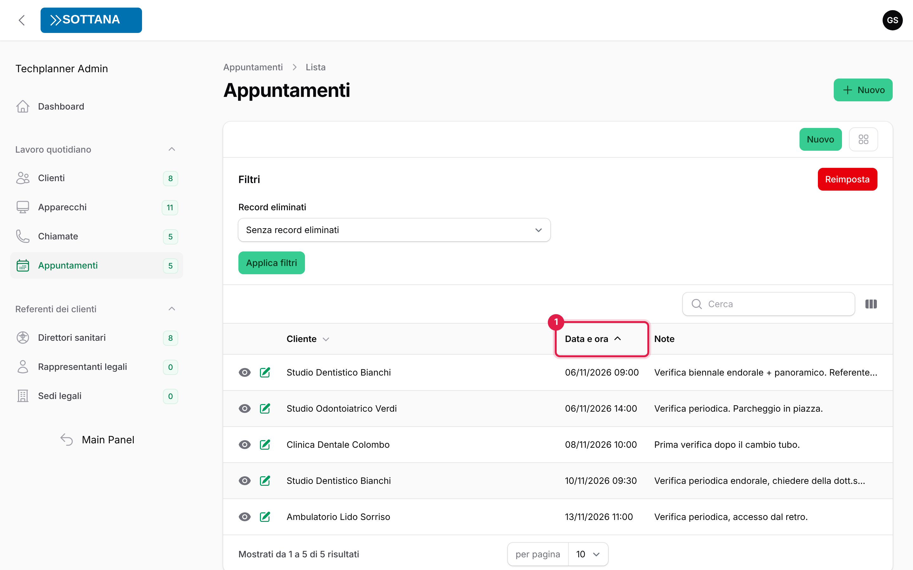

*Figura 14 — L'elenco degli appuntamenti in ordine di data.*

### Mettere in fila le visite vicine

Dopo aver fissato un appuntamento, puoi vedere quali altri clienti sono vicini e chiamarli per lo stesso giorno.

1. Torna all'elenco **Clienti**.
2. Sulla riga del cliente già fissato premi **Ordina per distanza**.
3. La colonna **Distanza** (riquadro **1**) si riempie con i chilometri in linea d'aria da quel cliente. In cima trovi i più vicini; in fondo, con «—», quelli senza indirizzo completo.

L'ordine resta finché non scegli un altro cliente, anche se chiudi e riapri il browser.

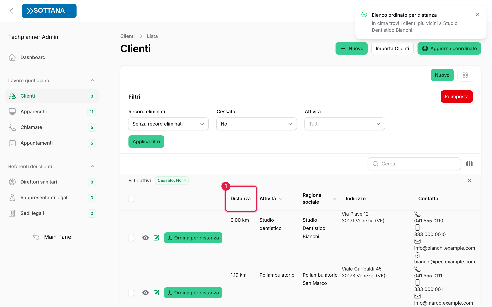

*Figura 15 — I clienti in ordine di distanza da Studio Dentistico Bianchi.*

Se un cliente non ha le coordinate compare l'avviso «Mancano le coordinate». Premi **Aggiorna coordinate** in cima all'elenco e conferma con **Sì, aggiorna tutto**: il sistema calcola le coordinate dall'indirizzo per tutti i clienti che non le hanno. Per farlo solo su alcuni, spunta le loro righe e scegli «Aggiorna coordinate» dalle azioni di gruppo. Se non succede nulla, avvisa l'amministratore: il calcolo usa un servizio di mappe esterno che va configurato.

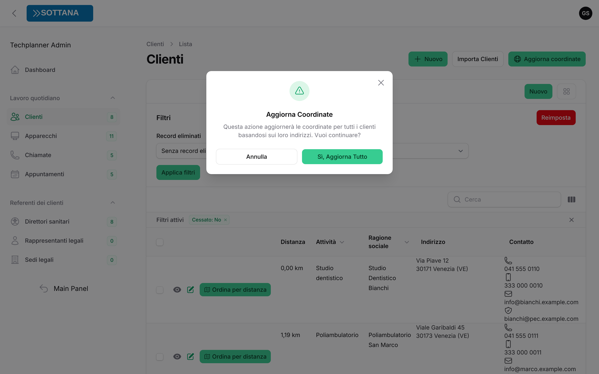

*Figura 16 — La conferma di Aggiorna coordinate.*

## Tecnico: apparecchi e verifiche

Ogni apparecchio radiologico appartiene a un cliente. Ogni volta che lo controlli registri una **verifica**, con la data del prossimo controllo.

### Trovare un apparecchio

Nel menu clicca **Apparecchi**. Nella casella **Cerca** (riquadro **1**) puoi scrivere il nome del cliente, la marca, il modello o una matricola. Per aprire la scheda di un apparecchio premi l'occhio sulla sua riga (riquadro **2**).

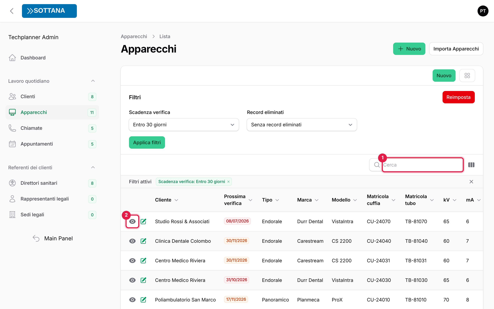

*Figura 17 — L'elenco degli apparecchi.*

### Registrare una verifica

1. Apri la scheda dell'apparecchio. In alto ci sono i dati (cliente, tipo, marca, modello, matricole, kV, mA).
2. Scorri in basso fino a **Verifiche** (riquadro **1**): è lo storico dei controlli, dal più recente.
3. Premi **Nuovo** (riquadro **2**).

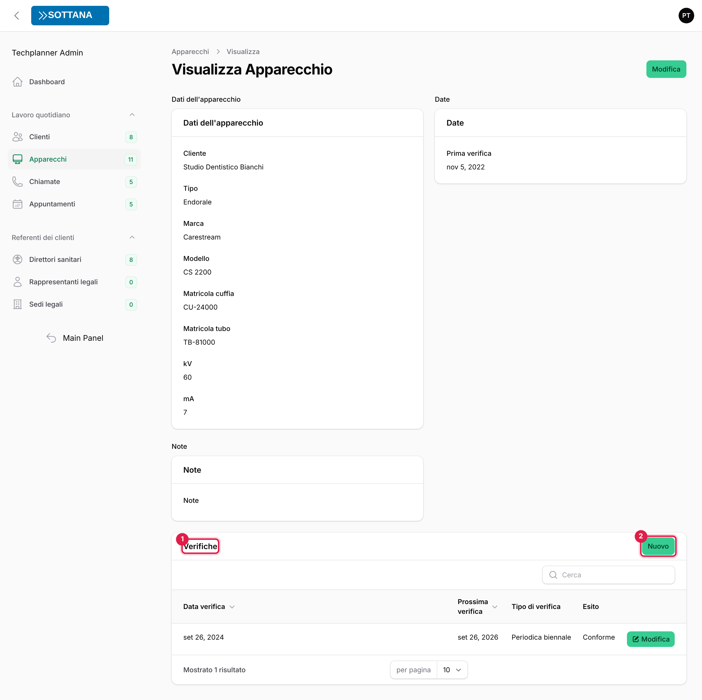

*Figura 18 — La scheda dell'apparecchio con lo storico delle verifiche.*

4. Compila la finestra:
   - **Data verifica**: il giorno in cui hai fatto il controllo;
   - **Prossima verifica**: quando tornare. Non può essere prima della data della verifica;
   - **Tipo di verifica**: per esempio «Periodica biennale»;
   - **Esito**: per esempio «Conforme»;
   - **Parametri di esposizione** e **Note**: facoltativi.
5. Premi **Salva**. I campi con l'asterisco sono obbligatori.

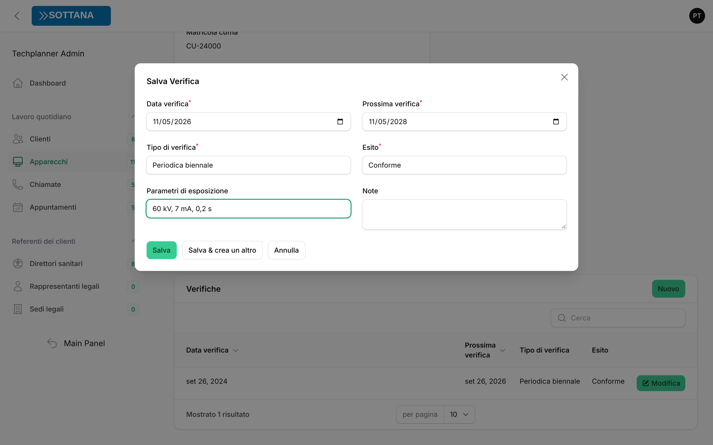

*Figura 19 — La finestra di una verifica nuova.*

### Sapere quali apparecchi vanno verificati

Nell'elenco **Apparecchi** la colonna **Prossima verifica** (riquadro **2**) dice quando tornare, presa dall'ultima verifica registrata. Il colore aiuta: **rosso** = scaduta, **giallo** = entro 30 giorni, **verde** = più avanti, «—» = mai verificato.

Per vedere solo quelli da fare apri **Filtri** e scegli **Scadenza verifica** (riquadro **1**): *Scadute*, *Entro 30 / 60 / 90 giorni* oppure *Mai verificati*. Poi premi **Applica filtri**. Lo stesso elenco, già pronto, è sulla pagina iniziale.

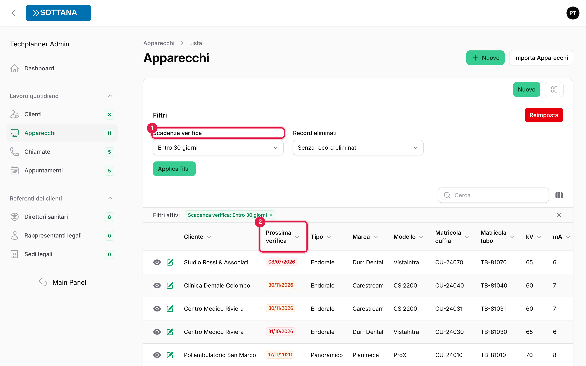

*Figura 20 — Gli apparecchi da verificare entro 30 giorni.*

### Aggiungere un apparecchio

1. Nel menu clicca **Apparecchi**, poi **Nuovo**. (Oppure dalla scheda del cliente: linguetta **Apparecchi**, poi **+**; il cliente è già scelto.)
2. Scegli il **Cliente** e compila tipo (endorale, panoramico…), marca, modello, matricola della cuffia e del tubo, kV e mA come sulla targhetta.
3. Se lo sai, scrivi la **Data prima verifica**.
4. Premi **Salva**.

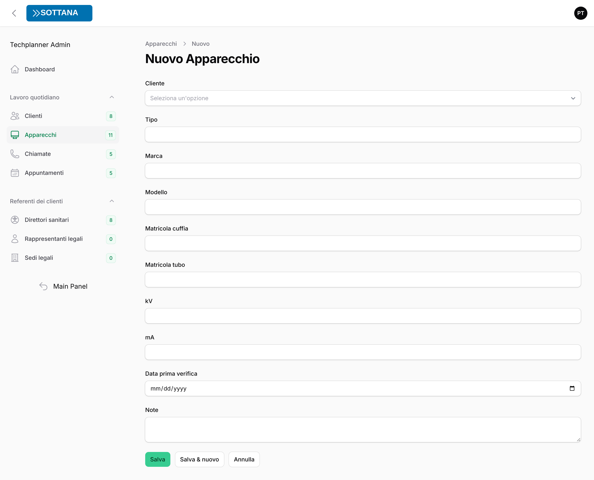

*Figura 21 — Il modulo per un apparecchio nuovo.*

Apparecchio messo sul cliente sbagliato? Apri la scheda, premi **Modifica**, cambia il **Cliente** e salva: le sue verifiche lo seguono.

## Referenti dei clienti

Sono le persone e gli indirizzi che servono nei documenti di verifica. Si trovano nel gruppo **Referenti dei clienti** del menu, e anche come linguette dentro la scheda di ogni cliente: aggiungerli da lì è più comodo, perché il cliente è già scelto.

| Voce | Cosa contiene | Cosa scrivere |
| --- | --- | --- |
| Direttori sanitari | Il medico responsabile dello studio | Nome (obbligatorio), e-mail, telefono, numero di iscrizione all'albo, specializzazione, scadenza dell'iscrizione, note |
| Rappresentanti legali | Chi firma per il cliente | Nome, numero di documento, telefono, e-mail |
| Sedi legali | L'indirizzo legale, se diverso da quello dello studio | Nome, indirizzo, telefono, e-mail |

Quando cambia il direttore sanitario, aggiungi il nuovo invece di sovrascrivere il vecchio: così resta traccia di chi c'era prima.

I direttori sanitari si possono anche importare da un file CSV con **Importa Direttori sanitari**, come per i clienti.

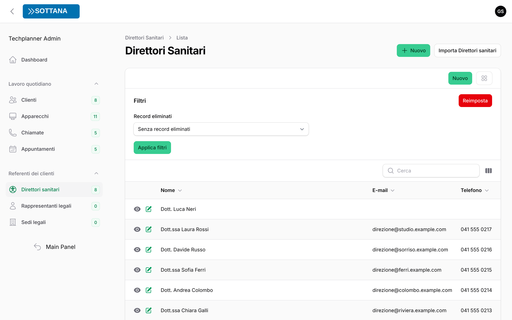

*Figura 22 — L'elenco dei direttori sanitari.*

## Amministratore: utenti e permessi

L'amministratore crea gli account e decide chi può entrare dove. Gli utenti non si gestiscono nel pannello TechPlanner ma in quello del modulo **User**.

### Raggiungere la gestione utenti

1. Entra nel pannello TechPlanner e premi **Main Panel** in fondo al menu.
2. Nella pagina principale, sotto **Modules**, clicca **User**.

*Figura 23 — Il pannello principale con i moduli.*

In alto trovi i numeri degli utenti (totali, attivi, accessi delle ultime 24 ore) e sotto l'elenco.

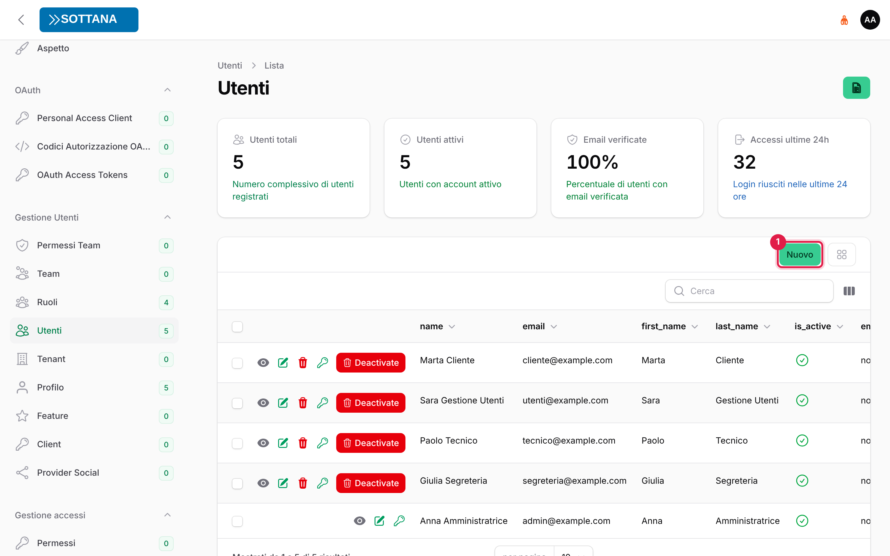

*Figura 24 — L'elenco degli utenti.*

### Creare un utente

1. Premi **Nuovo** (riquadro **1** della figura 24).
2. Scrivi nome, cognome, e-mail, il nome completo nel campo **name** e una password. La password deve avere almeno 12 caratteri, con una maiuscola, una minuscola, un numero e un simbolo.
3. Premi **Salva**.

Alcune etichette di questo modulo sono ancora in inglese o tecniche (first\_name, worker, empty): è un limite noto, i campi funzionano.

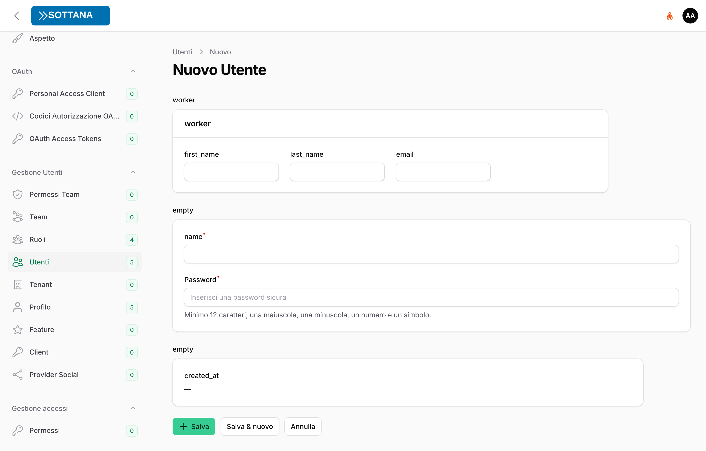

*Figura 25 — Il modulo per un utente nuovo.*

### Dare il ruolo giusto

Un utente senza ruolo non riesce a entrare in nessun pannello.

1. Nell'elenco utenti premi la matita sulla riga della persona.
2. In basso clicca la linguetta **Organizzazione** (riquadro **1**). La prima tabella sono i **ruoli**.
3. Premi l'icona a catena («collega») in alto a destra della tabella, scegli il ruolo e conferma.
4. Per togliere un ruolo premi la X rossa sulla sua riga.

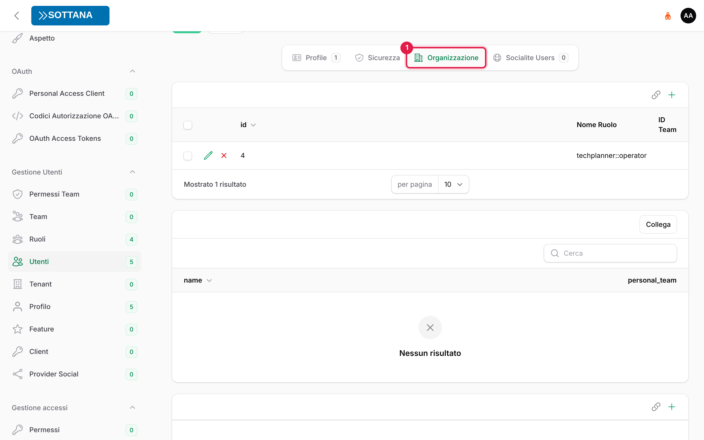

*Figura 26 — I ruoli di un utente, nella linguetta Organizzazione.*

Ruoli disponibili:

| Ruolo | A cosa serve |
| --- | --- |
| `techplanner::operator` | Segreteria e tecnici: entrano nel pannello TechPlanner, consultano, creano e modificano, ma non eliminano |
| `techplanner::admin` | Responsabile dei dati: come l'operatore, più eliminare, ripristinare dal cestino e gestire i modelli e-mail |
| `user::admin` | Entrare nella gestione utenti |
| `super-admin` | Amministratore: entra in tutti i pannelli e può fare tutto |

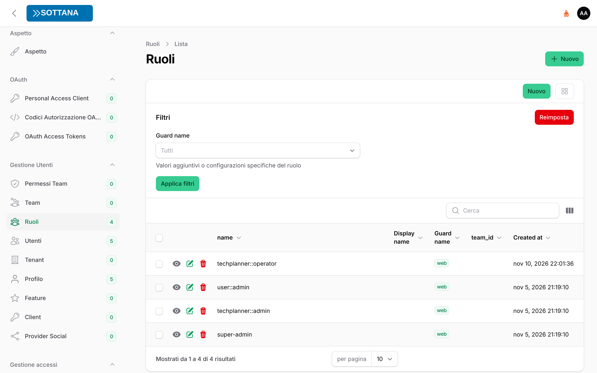

*Figura 27 — L'elenco dei ruoli.*

### Ripristinare dal cestino

Quando qualcuno elimina un cliente, un apparecchio o un'altra scheda, non la cancella per sempre: finisce nel **cestino**, insieme alle cose che le appartengono (eliminando un cliente vanno nel cestino anche i suoi apparecchi, verifiche, chiamate e referenti).

1. Apri l'elenco (per esempio **Clienti**) e poi **Filtri**.
2. In **Record eliminati** (riquadro **1**) scegli *Solo record eliminati* e premi **Applica filtri**.
3. Sulla riga premi la freccia **Ripristina** (riquadro **2**): la scheda torna al suo posto con tutto quello che era stato eliminato con lei.
4. Il cestino rosso su quella riga invece la **elimina definitivamente**: non si torna indietro.

Solo `techplanner::admin` e l'amministratore vedono questi pulsanti.

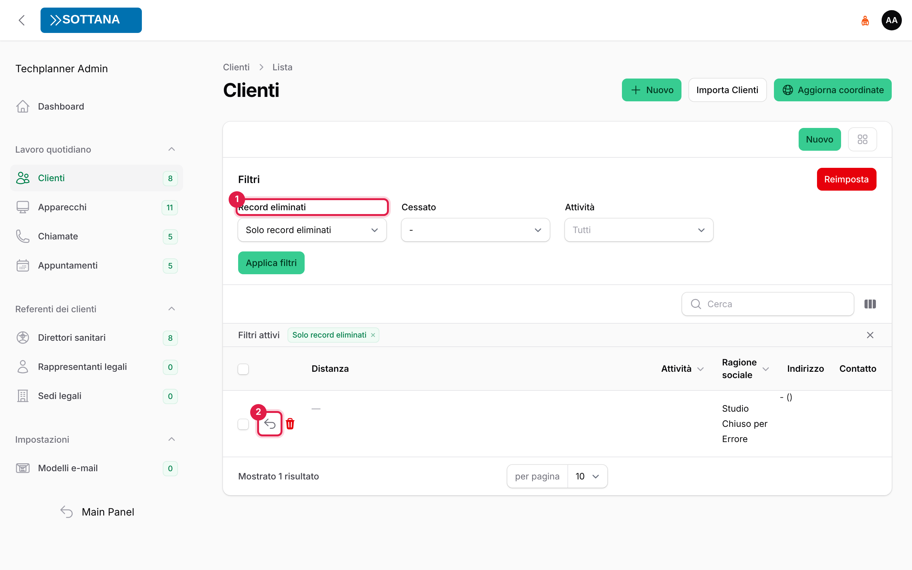

*Figura 28 — Un cliente nel cestino, con Ripristina.*

### Disattivare chi non lavora più

Nell'elenco utenti, il pulsante rosso **deactivate** sulla riga blocca l'accesso senza cancellare lo storico. È meglio che eliminare l'utente.

## Clienti e visitatori del sito

Chi non lavora in studio vede solo il sito pubblico, non il pannello. Per usarlo non servono account né ruoli.

*Figura 29 — La pagina iniziale del sito.*

### Chiedere una consulenza

1. Nel menu del sito clicca **Contatti**, oppure il pulsante **Richiedi Consulenza**.
2. Compila il modulo: **Nome e Cognome**, **Email**, **Tipo di servizio richiesto** e **Messaggio** sono obbligatori (asterisco). Telefono e Azienda/Studio aiutano a richiamarti prima.
3. Invia. La richiesta viene salvata, compare nel pannello sotto **Richieste dal sito** e arriva per e-mail allo studio, all'indirizzo che ha impostato l'amministratore.

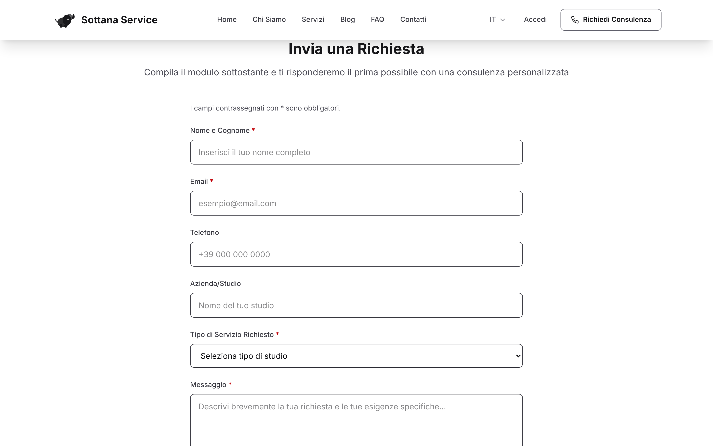

*Figura 30 — Il modulo dei contatti.*

### Registrarsi

Da **Accedi** in alto puoi creare un account: servono nome, cognome, e-mail, una password (almeno 8 caratteri con maiuscola, minuscola, numero e simbolo) e l'accettazione di privacy e condizioni. Oggi l'account non apre un'area clienti con apparecchi o verifiche: serve solo per i servizi del sito.

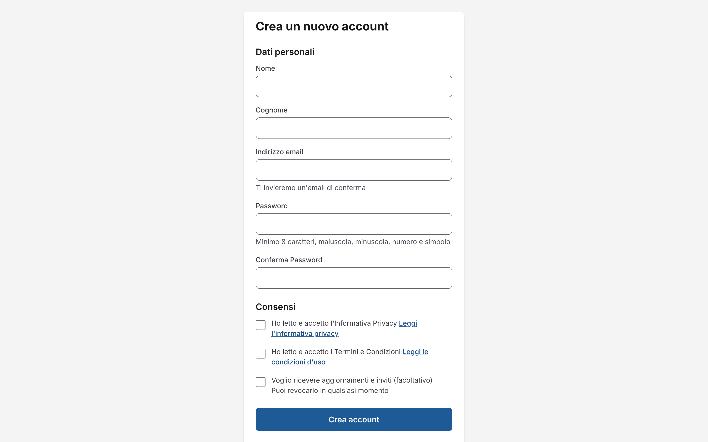

*Figura 31 — La registrazione dal sito.*

## Se qualcosa non va

### Domande frequenti

| Cosa succede | Cosa fare |
| --- | --- |
| «I dati di accesso non sono corretti» ma la password è giusta | Al tuo utente manca il ruolo del pannello: chiedi all'amministratore (capitolo Amministratore) |
| Ho eliminato una scheda per sbaglio | Chiedi al responsabile dei dati di ripristinarla dal cestino (capitolo Amministratore) |
| Non vedo il cestino rosso | È normale per segreteria e tecnici: eliminare spetta al responsabile dei dati |
| «La partita IVA non è valida» | Ricontrolla le cifre sul documento: di solito due cifre sono scambiate |
| Non riesco più a provare l'accesso | Troppi tentativi sbagliati: aspetta qualche minuto |
| Non trovo un cliente | Il filtro «Cessato» nasconde chi ha chiuso: mettilo su *Tutti* e premi Applica filtri |
| La colonna Distanza mostra «—» | Non hai ancora scelto un cliente di partenza, oppure quel cliente non ha l'indirizzo completo |
| «Mancano le coordinate» | Completa l'indirizzo del cliente e premi Aggiorna coordinate |
| Il salvataggio non parte | Manca un campo con l'asterisco rosso: il campo vuoto è evidenziato |
| L'importazione ha saltato delle righe | La notifica di fine dice quante: correggi solo quelle righe nel file e reimportale |

### Limiti di oggi

- Se un cliente ha chiuso, mettilo «Cessato» invece di eliminarlo: resta consultabile senza ingombrare l'elenco.
- **Nessun calendario grafico** e nessun tecnico assegnato agli appuntamenti: gli appuntamenti si leggono nell'elenco ordinato per data e nel «giro di oggi».
- Operatori e responsabili vedono gli stessi clienti: non ci sono clienti riservati a un solo tecnico.
- Alcune schermate della gestione utenti hanno ancora etichette in inglese.
